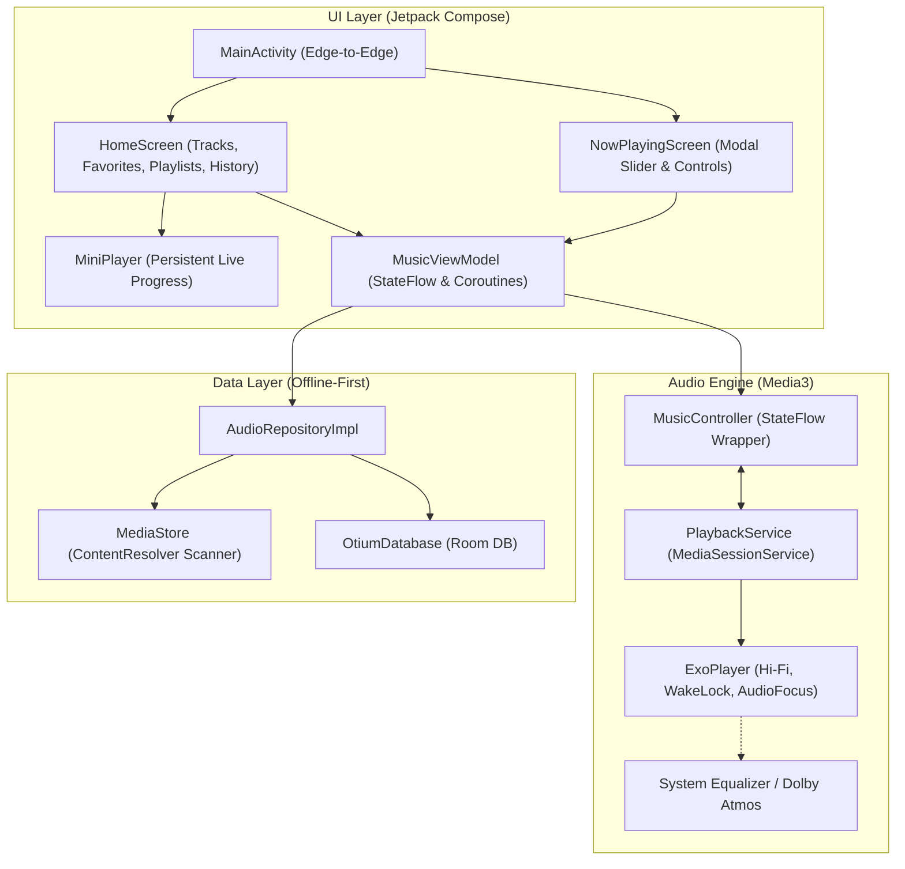

# 🎵 Otium Audio

**Otium Audio** is a high-performance, offline-first, native music player built for Android using cutting-edge technologies and modern architecture. Engineered from the ground up for low latency, zero playback interruptions, and high-fidelity local audio playback.

---

## 🌟 Key Features

- **🚀 AndroidX Media3 & ExoPlayer Engine (v1.5+):** 
  Modern media architecture leveraging `MediaSessionService` and `ExoPlayer`. No legacy `MediaPlayer` or deprecated `MediaBrowserServiceCompat`.
- **🛡️ Rock-Solid Background Playback:**
  Configured as a foreground service with `foregroundServiceType="mediaPlayback"`. Engineered to survive aggressive OEM battery killers (MIUI / HyperOS / Samsung OneUI) using `WAKE_MODE_LOCAL`.
- **🎛️ System DSP & Equalizer Injection:**
  Exposes the system `audioSessionId` via standard Android audio effect control broadcasts (`ACTION_OPEN_AUDIO_EFFECT_CONTROL_SESSION`). Seamlessly hooks into hardware equalizers such as **Dolby Atmos**, **Dirac**, **Xiaomi Sound**, and **Wavelet**.
- **🎧 Seamless Interruption Handling:**
  Automatic audio focus ducking/pausing for phone calls and navigation directions. Automatic pause on headphone disconnect via `ACTION_AUDIO_BECOMING_NOISY`.
- **📂 Scoped Storage & Fast MediaStore Scanner:**
  Asynchronously queries local audio files with ContentResolver and Scoped Storage safety. Intelligent filters eliminate short audio files (< 30 seconds) like ringtones and voice notes.
- **💾 Room Database Persistence:**
  Local offline persistence for custom user playlists, track favorites, and recent playback history.
- **🎨 Edge-to-Edge Jetpack Compose (Material 3):**
  Minimalist dark luxury aesthetic (Obsidian & Brushed Gold) featuring smooth slider controls, dynamic album artwork rendering via Coil, persistent floating `MiniPlayer`, and a full-screen `NowPlayingScreen` with interactive gesture dismissals.

---

## 📐 Architecture Overview



---

## 🛠️ Tech Stack & Requirements

- **Language:** 100% Kotlin (Coroutines, StateFlow, Flow)
- **UI Framework:** Jetpack Compose (Material 3, Edge-to-Edge)
- **Audio Engine:** AndroidX Media3 (ExoPlayer & MediaSessionService)
- **Local Database:** Android Room 2.6.1
- **Image Loading:** Coil 2.7.0
- **Min SDK:** API 24 (Android 7.0 Nougat)
- **Target SDK / Compile SDK:** API 35 (Android 15)
- **JDK:** Java 17

---

## 📦 Project Structure

```
app/src/main/
├── AndroidManifest.xml                  # Foreground service & scoped permissions
├── java/com/otium/audio/
│   ├── OtiumApplication.kt              # App initialization & DI container
│   ├── data/
│   │   ├── local/ (OtiumDatabase, AudioDao, Entities)
│   │   ├── model/ (Song data class & MediaItem mapping)
│   │   └── repository/ (AudioRepository & AudioRepositoryImpl)
│   ├── playback/
│   │   ├── PlaybackService.kt           # MediaSessionService, notification & DSP
│   │   ├── MusicController.kt           # MediaController coroutine wrapper
│   │   └── MusicPlaybackState.kt        # Immutable playback state
│   └── ui/
│       ├── MainActivity.kt              # Edge-to-edge entry point
│       ├── components/ (MiniPlayer, SongListItem, TrackSlider)
│       ├── screens/ (HomeScreen, NowPlayingScreen, PermissionScreen)
│       ├── theme/ (Color, Theme, Typography)
│       └── viewmodel/ (MusicViewModel, MusicUiState)
└── res/                                 # Strings, adaptive vector icons, themes
```

---

## 📄 License

This project is open-source under the terms of the GNU General Public License v3.0 or repository default.
