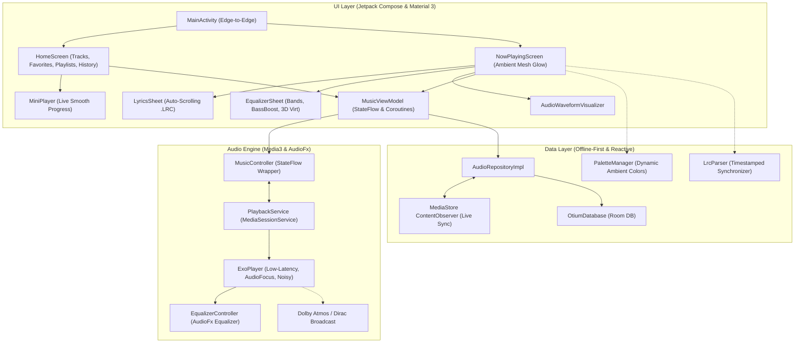

# 🎵 Otium Audio

**Otium Audio** is an ultra-high-performance, offline-first, native audiophile music player built for Android. Crafted without shortcuts or AI slop, it combines precision low-latency audio architecture, AndroidX Media3 (v1.5+), hardware DSP integration, and physics-based fluid Jetpack Compose UI.

---

## 🌟 Elite Feature Set

- **🚀 AndroidX Media3 & ExoPlayer Engine (v1.5+):** 
  Modern foreground playback via `MediaSessionService` with zero deprecated legacy APIs (`MediaPlayer` or `MediaBrowserServiceCompat`).
- **🛡️ Rock-Solid Background Playback:**
  Configured with `foregroundServiceType="mediaPlayback"`, `WAKE_MODE_LOCAL`, and built-in **OEM Battery Killer Defense** (MIUI / HyperOS / Samsung OneUI) to prevent sudden playback cutoffs when the screen turns off.
- **🎛️ Dual-Layer Equalizer & DSP Injection:**
  - **Internal Multi-Band Equalizer:** Real-time 5/10-band hardware equalizer with Bass Boost (0–100%), 3D Virtualizer (0–100%), and audiophile presets (Rock, Pop, Jazz, Electronic, Acoustic, Flat).
  - **System DSP Auto-Hook:** Broadcasts `audioSessionId` on session creation, enabling system-wide sound enhancements like **Dolby Atmos**, **Dirac**, **Xiaomi Sound**, and **Wavelet**.
- **🎨 Dynamic Ambient Glow (Palette Extraction):**
  Extracts dominant, vibrant, and dark-vibrant colors directly from album artwork using the AndroidX Palette API, smoothly morphing the entire `NowPlayingScreen` background into an ambient mesh glow.
- **📜 Live Synchronized Lyrics (.LRC Engine):**
  Parses standard `.lrc` timestamped lyrics, automatically scrolling to the current sung line with glow effects, and allowing users to tap any line to seek playback instantly.
- **🌊 Interactive Audio Waveform Visualizer:**
  Live frequency bar visualizer that rhythmically animates to music playback with dynamic gradient styling.
- **⚡ Physics-Based Album Art Gestures & Haptics:**
  Horizontal swipe on album art with realistic spring resistance and tactile haptic feedback to skip next or previous tracks.
- **🔄 Real-time MediaStore ContentObserver:**
  Reactively monitors Android's MediaStore in the background using `callbackFlow`. Any music downloaded or deleted reflects in the library instantly without app restarts.
- **⏩ Variable Playback Speed:**
  Audiophile speed control supporting 0.75x, 1.0x, 1.25x, 1.5x, and 2.0x pitch-preserved playback.
- **🌙 Smart Sleep Timer with Acoustic Fade-Out:**
  Presets (15m, 30m, 45m, 60m, 90m) or "End of Track" with smooth 30-second volume fade down to prevent waking listeners.
- **📑 Queue Management (Up Next):**
  Full queue inspection, track reordering (move up/down), swipe-to-delete, play next, and add to queue.
- **📁 Physical Folder Hierarchy Browser:**
  Deep directory scanning that groups tracks into physical device folders with a dedicated "Play All" option.
- **🔤 Fast A-Z Alphabet Scroller:**
  Precision vertical alphabet index with haptic clicks to jump instantly across massive music libraries.
- **💾 Room Database Persistence:**
  Full reactive database for user playlists, instant track favorites, and recent play history.

---

## 📐 Architecture Overview



---

## 🛠️ Tech Stack & Requirements

- **Language:** 100% Kotlin (Coroutines, StateFlow, callbackFlow)
- **UI Framework:** Jetpack Compose (Material 3, Spring Physics, Edge-to-Edge)
- **Audio Engine:** AndroidX Media3 1.5.1 (ExoPlayer & MediaSessionService)
- **Audio Effects:** Android AudioFx (Equalizer, BassBoost, Virtualizer)
- **Color Extraction:** AndroidX Palette KTX 1.0.0
- **Image Loading:** Coil 2.7.0
- **Local Database:** Android Room 2.6.1
- **Min SDK:** API 24 (Android 7.0 Nougat)
- **Target SDK / Compile SDK:** API 35 (Android 15)
- **JDK:** Java 17

---

## 📦 Project Structure

```
app/src/main/
├── AndroidManifest.xml
├── java/com/otium/audio/
│   ├── OtiumApplication.kt
│   ├── data/
│   │   ├── local/ (OtiumDatabase, AudioDao, Entities)
│   │   ├── lyrics/ (Lyrics.kt, LrcParser)
│   │   ├── model/ (Song data class)
│   │   └── repository/ (AudioRepository & AudioRepositoryImpl)
│   ├── playback/
│   │   ├── BatteryOptimizationHelper.kt # OEM Battery Killer Defense
│   │   ├── EqualizerController.kt       # Multi-band EQ, BassBoost, Virtualizer
│   │   ├── MusicController.kt           # MediaController wrapper with StateFlow
│   │   ├── MusicPlaybackState.kt        # Immutable playback state
│   │   └── PlaybackService.kt           # MediaSessionService, notification & DSP
│   └── ui/
│       ├── MainActivity.kt              # Edge-to-edge entry point
│       ├── components/ 
│       │   ├── AudioWaveformVisualizer.kt
│       │   ├── EqualizerSheet.kt
│       │   ├── LyricsSheet.kt
│       │   ├── MiniPlayer.kt
│       │   ├── SongListItem.kt
│       │   └── TrackSlider.kt
│       ├── screens/ (HomeScreen, NowPlayingScreen, PermissionScreen)
│       ├── theme/ (Color, PaletteExtractor, Theme, Typography)
│       └── viewmodel/ (MusicViewModel, MusicUiState)
└── res/
```

---

## 📄 License

This project is licensed under the terms of the GNU General Public License v3.0.
